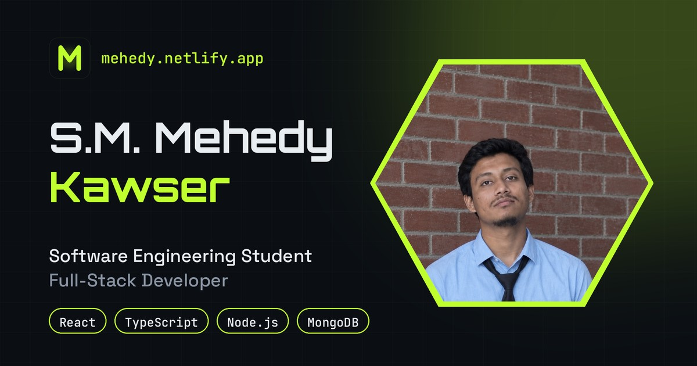

 

---

## 👋 &nbsp;About me

I'm a final-year **B.Sc. Software Engineering** student at **Daffodil International University**, graduating in **December 2026**. I like turning ideas into working software — SaaS platforms, end-to-end encrypted messaging, land-measurement tools, numerical-methods visualisers — from SaaS platforms to interactive learning tools.

I've led teams through hackathons, academic presentations and project courses, and I'm writing my undergraduate thesis on **deepfake detection** with a lightweight CNN.

<table>
<tr>
<td>🎓 &nbsp;<b>Studying</b> Software Engineering, DIU</td>
<td>🔬 &nbsp;<b>Researching</b> Forensic-cue CNNs for deepfake detection</td>
<td>🛠️ &nbsp;<b>Building</b> Full-stack web apps &amp; interactive tools</td>
<td>🏆 &nbsp;<b>Competing</b> Hackathons &amp; AI competitions (2026)</td>
</tr>
</table>

---

## 🧰 &nbsp;Tech stack

 

 

 

 

---

## 🚀 &nbsp;Projects

### ⭐ Featured

| Project | What it is | Built with | Links |
|:--|:--|:--|:--|
| [**Numerical Analysis Workbench**](https://mehedyk.github.io/Numerical-Analysis/) | Root-finding, drawn out step by step. | `JavaScript` · `Math parser` · `GitHub Pages` | [Live](https://mehedyk.github.io/Numerical-Analysis/) · [Code](https://github.com/mehedyk/Numerical-Analysis) |
| [**Portfolio Builder**](https://portfolio-by-galacticos.vercel.app/) | Create a professional portfolio in minutes. | `React` · `Vercel` | [Live](https://portfolio-by-galacticos.vercel.app/) |
| [**Fard Vault**](https://fard-vault.vercel.app/) | Your secrets. Your control. Zero knowledge. | `AES-256-GCM` · `Argon2id` · `Next.js` · `Vercel` | [Live](https://fard-vault.vercel.app/) |
| [**Sirr — Encrypted Messenger**](https://sirr-connect.vercel.app/) | End-to-end encrypted. Zero knowledge. Yours alone. | `X25519` · `AES-256-GCM` · `Next.js` · `Vercel` | [Live](https://sirr-connect.vercel.app/) |
| [**JomiMap**](https://jomimap.vercel.app/) | Measure land straight off a map — no survey crew required. | `Next.js` · `Canvas` · `Bangla i18n` | [Live](https://jomimap.vercel.app/) |

<b>📂 &nbsp;All 22 projects</b> — click to expand

 

| Project | What it is | Built with | Links |
|:--|:--|:--|:--|
| [**Fard — Password Generator**](https://fard-pw.netlify.app/) | Uniqueness isn't special. It's expected. | `JavaScript` · `Netlify` | [Live](https://fard-pw.netlify.app/) |
| [**হাদি — Quran Reference**](https://hadi-quran-guide.vercel.app/) | Verified ayat, tafsir, and search — in Bangla. | `Next.js` · `Bangla i18n` | [Live](https://hadi-quran-guide.vercel.app/) |
| [**Taqaddum — Islamic Task Tracker**](https://task-tracker-taqaddum.vercel.app/) | Progress — Salah, habits, fitness, and team accountability, in one place. | `Next.js` · `PWA` · `Vercel` | [Live](https://task-tracker-taqaddum.vercel.app/) |
| [**Algo Visualizer**](https://algorithm-visualizer-seven-blue.vercel.app/) | Sorting, graphs, trees, and pathfinding — watched in 3D. | `Three.js` · `JavaScript` · `Vercel` | [Live](https://algorithm-visualizer-seven-blue.vercel.app/) |
| [**MealON**](https://mealon.vercel.app/) | Mess management for Bangladeshi students, without the spreadsheet headache. | `Next.js` · `Vercel` | [Live](https://mealon.vercel.app/) |
| [**StudyGlobe**](https://study-globe-system.vercel.app/) | A study-abroad preparation system, from shortlist to visa. | `Next.js` · `Vercel` | [Live](https://study-globe-system.vercel.app/) |
| [**Sukuun — 3D Particle System**](https://sukuun.netlify.app/) | A calming 3D particle field you can lose a few minutes in. | `Three.js` · `WebGL` · `Vite` · `Tailwind CSS` | [Live](https://sukuun.netlify.app/) · [Code](https://github.com/mehedyk/Sukuun--3D-Particle-System) |
| **QiyamBreak** | A break reminder that also cares about your prayers. | `Python` · `PyQt6` · `PyInstaller` | [Code](https://github.com/mehedyk/QiyamBreak) |
| [**Hospital Management System**](https://mehedyk.github.io/Hospital-Management/) | A hospital admin/doctor/patient system, built to study encryption, not to go live. | `JavaScript` · `One-Time Pad encryption` · `GitHub Pages` | [Live](https://mehedyk.github.io/Hospital-Management/) · [Code](https://github.com/mehedyk/Hospital-Management) |
| [**The Chira Incident — Case #0001**](https://mehedyk.github.io/Chira-Report/) | A deadpan forensic chemistry report on a jar that should never have been opened. | `HTML/CSS` · `Bangla/English bilingual` | [Live](https://mehedyk.github.io/Chira-Report/) · [Code](https://github.com/mehedyk/Chira-Report) |
| [**The Weaponization of Liberation**](https://mehedyk.github.io/The-Weaponization-of-Liberation/) | A data-visualization essay on family, crime, and welfare statistics in Bangladesh. | `Data visualization` · `Research` · `HTML/CSS` | [Live](https://mehedyk.github.io/The-Weaponization-of-Liberation/) · [Code](https://github.com/mehedyk/The-Weaponization-of-Liberation) |
| [**Marine Dreamer**](https://marinedreamer.netlify.app/) | Admission coaching for Bangladesh's marine academies. | `HTML/CSS` · `Netlify` | [Live](https://marinedreamer.netlify.app/) |
| [**Dristy Computer Training Center**](https://dristy-institute.netlify.app/) | A government-approved computer training institute in Gopalpur, online. | `HTML/CSS` · `Netlify` | [Live](https://dristy-institute.netlify.app/) |
| [**AI Lab — DIU**](https://team-ai-diu.github.io/Artificial-Intelligence-Lab/) | Research site for the Artificial Intelligence Lab, EEE Dept., Daffodil International University. | `HTML/CSS` · `GitHub Pages` | [Live](https://team-ai-diu.github.io/Artificial-Intelligence-Lab/) |
| [**Salami**](https://salami-saas.vercel.app/login) | A SaaS platform, currently gated behind account login. | `Next.js` · `Vercel` | [Live](https://salami-saas.vercel.app/login) |
| **GALACTICOs Super Shop** | A CLI shop-management system in plain C — admin, employee, and customer roles. | `C` · `GCC` | [Code](https://github.com/mehedyk/supershop-c-cli) |
| **Library Management System** | A desktop library system built with Java Swing. | `Java` · `Swing` | [Code](https://github.com/mehedyk/library-management-system-java-gui) |

### 🏁 Built for competitions

| Project | Event | What it does |
|:--|:--|:--|
| **LandTech — Fraud & Double-Selling Detection** | LandTech Innovation Hackathon 2026 · *Team Ardh* (CSE × Law, DIU) | Rule-based engine that flags suspicious land-transfer chains and double-selling, with an officer dashboard and a bilingual (Bangla/English) citizen page. |
| **Prohori — Mobile Wallet Scam Shield** | AI Dev Fest 2026 · Track 01: *Trust & Risk* | Prototype that holds suspicious mobile-wallet transfers before money leaves the account. |

---

## 🎓 &nbsp;Academic

<table>
<tr><th align="left">Degree</th><th align="left">Institution</th><th align="left">Period</th><th align="left">Result</th></tr>
<tr><td><b>B.Sc. Software Engineering</b></td><td>Daffodil International University, Dhaka</td><td>2023 – Dec 2026</td><td>CGPA <b>3.50</b> / 4.00</td></tr>
<tr><td>Higher Secondary Certificate</td><td>Notre Dame College, Mymensingh</td><td>2021</td><td>GPA <b>4.92</b> / 5.00</td></tr>
<tr><td>Secondary School Certificate</td><td>Suti VM Pilot Model Government High School</td><td>2019</td><td>GPA <b>4.86</b> / 5.00</td></tr>
</table>

### 🔬 Undergraduate thesis *(ongoing)*

> **A Lightweight CNN with Forensic Cue Features for Deepfake Detection**
> Building a consent-based, Bangladeshi-context deepfake video dataset and a lightweight CNN that combines four forensic cues — **error level analysis**, **noise residual**, **blending boundary** and **DCT frequency** features.
> *Supervisor: Afsana Begum, DIU*

### 🏆 Hackathons & competitions

- **DIU AI Project Competition 2026** — selected for the **final round** *(Department of CIS, DIU)*
- **LandTech Innovation Hackathon 2026** — participated as **Team Ardh** *(Departments of CSE and Law, DIU)*
- **AI Hackathon, AI Dev Fest 2026** — participated · **Certificate of Appreciation**, 7 October 2026 *(DIU CPC, Department of CSE)*

---

## 📊 &nbsp;GitHub

---

## 🤝 &nbsp;Let's connect

Open to internships, junior roles and interesting collaborations. The quickest way to reach me is the contact form on **[mehedy.netlify.app](https://mehedy.netlify.app/#contact)** or **[LinkedIn](https://www.linkedin.com/in/mehedyk/)**.

 

